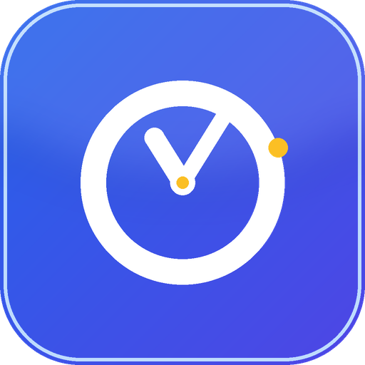
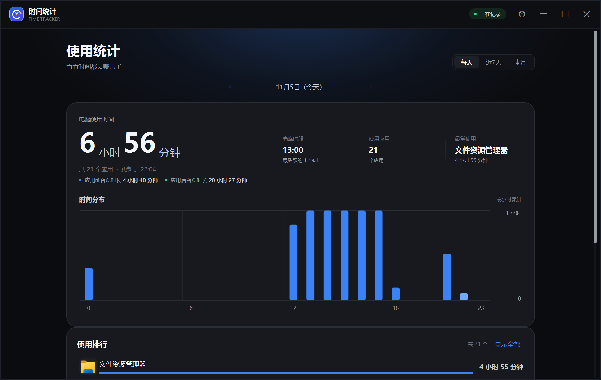
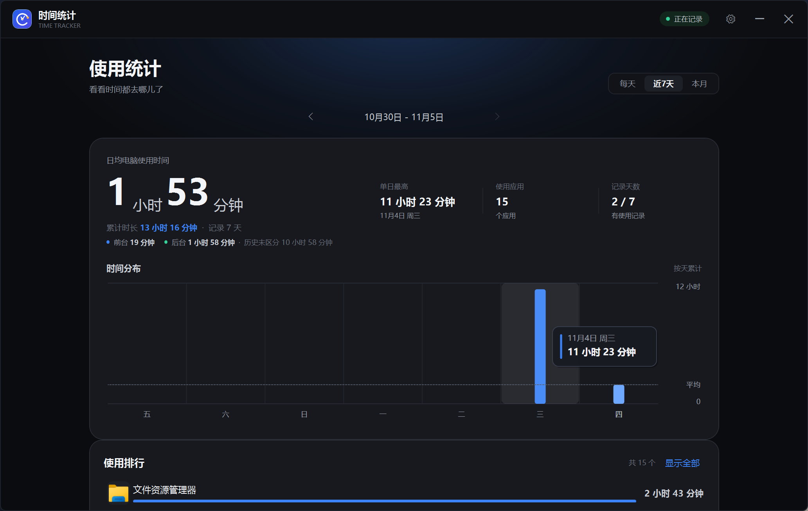
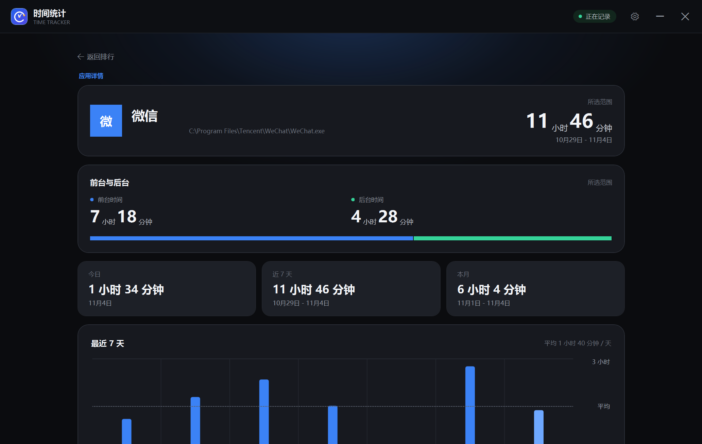
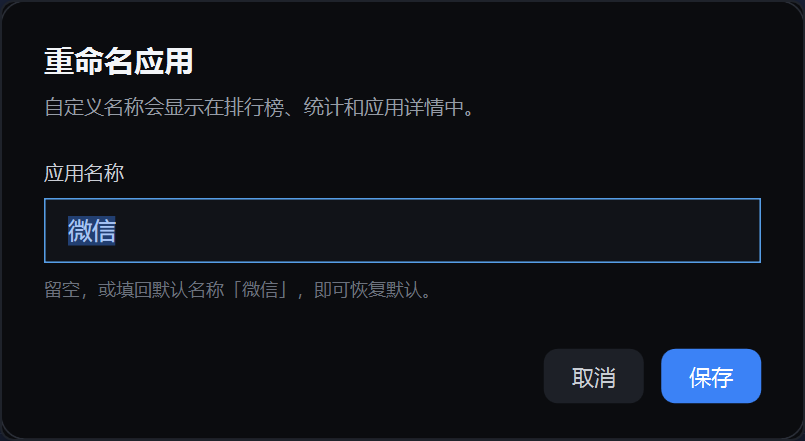

<div align="center">



# 时间统计 · TimeTrack

**看看时间花在了哪里。仅统计应用使用时长，不读取窗口内容，不联网。**

[](https://github.com/zh1chuan9/TimeTrack/releases/latest)
[](https://dotnet.microsoft.com/download/dotnet-framework)
[](LICENSE)

[下载最新版](https://github.com/zh1chuan9/TimeTrack/releases/latest) ·
[问题反馈](https://github.com/zh1chuan9/TimeTrack/issues) ·
[从源码构建](#从源码构建)

</div>



## 简介

TimeTrack 是一个轻量的 Windows 桌面应用使用时间统计工具。它记录前台活跃应用，也可以同时累计拥有可见窗口的后台/最小化应用，并按天、近 7 天、本月展示使用时长、24 小时分布和应用排行榜。

界面参考手机上的「使用统计」，深色卡片式布局；所有数据只保存在本机，不需要账号，也没有云端服务。

## 功能

- **前台 / 后台分开计时**：统计页展示当前范围的前台、后台合计；应用详情页展示拆分时长和占比条。
- **按天 / 近 7 天 / 本月查看**：支持向前、向后切换日期范围，查看历史记录。
- **时间分布图**：按小时或按天展示使用节奏，并标出平均值；鼠标移到柱子上可查看对应时间段和精确时长。
- **应用排行榜**：按使用时长排序，点击应用查看详情。
- **页面过渡动画**：在统计、应用详情、设置以及时间范围之间切换时，使用淡入和轻微滑动过渡。
- **轻量模式**：关闭页面过渡动画，降低界面刷新和后台扫描频率，并在隐藏到托盘后整理工作集，减少长期驻留时的 CPU 与内存占用。
- **应用管理**：关闭不想统计的应用开关，历史数据也会从统计中排除。
- **自定义应用名称**：给软件起一个更好认的名字，排行榜、详情、搜索和状态栏同步生效；留空即可恢复默认。
- **空闲自动暂停**：1 / 2 / 5 / 10 分钟无键鼠输入后停止计时。
- **托盘与开机自启**：关闭窗口后驻留托盘；可设置登录 Windows 后自动开始记录。
- **单实例运行**：重复打开会唤起已经运行的窗口。
- **本地优先**：数据为普通 JSON 文件，随时可以备份、导出或删除。

> **关于并行累计**：开启「记录后台应用」后，多个应用可以在同一秒同时累计。排行榜和合计是各应用计时秒数之和，因此可能大于自然时间，也可能超过 24 小时。

## 截图

**时间分布悬停查看**



**前台 / 后台拆分与应用详情**



**自定义应用名称**



## 下载与运行

1. 打开 [Releases](https://github.com/zh1chuan9/TimeTrack/releases/latest) 下载 `TimeTrack.exe`。
2. 放到一个固定目录，双击运行。免安装，不需要管理员权限。
3. 首次运行会在 `%APPDATA%\TimeTrack\` 创建数据目录。

系统要求：**Windows 10 / 11**，已启用 **.NET Framework 4.7.2 或更高版本**（Windows 10/11 默认自带）。

关闭主窗口后程序会隐藏到托盘，统计继续运行。右键托盘图标可以打开主窗口、暂停统计、切换开机自启或退出。

### 便携模式

如果不想把数据放在 `%APPDATA%`，可以用环境变量指定数据目录：

```bat
set TIMETRACK_DATA=E:\TimeTrackData
TimeTrack.exe
```

## 隐私

- 只读取进程路径、可执行文件路径和窗口标题，用于识别应用；**不读取窗口内容、不记录键盘输入、不截屏**。
- 不发起任何网络请求，不上传使用数据，不包含遥测或广告。
- 数据保存在本机，删除 `%APPDATA%\TimeTrack\` 即可清除。
- 程序没有购买代码签名证书，首次运行时 Windows SmartScreen 可能提示「未知发布者」。源码完全公开，也可以按下面的步骤自行构建。

## 从源码构建

项目是纯 C# WPF，不使用 XAML，也不依赖 NuGet。构建脚本直接调用 Windows 自带的 .NET Framework 编译器：

```bat
git clone https://github.com/zh1chuan9/TimeTrack.git
cd TimeTrack
python build\build.py
```

构建脚本会自动查找 .NET Framework 4.7.2+ 的引用程序集，输出根目录的 `TimeTrack.exe`。

如果引用程序集不在默认位置，可以显式指定：

```bat
set TIMETRACK_REFS=C:\Program Files (x86)\Reference Assemblies\Microsoft\Framework\.NETFramework\v4.7.2
python build\build.py
```

需要：

- Windows 10/11
- Python 3.8+（仅构建脚本使用）
- .NET Framework 4.7.2 Developer Pack，或完整的引用程序集目录

源码结构：

```text
src/
  Program.cs          入口、单实例、托盘启动
  MainWindow.cs       主窗口、统计页、详情页、设置页
  Controls.cs         开关、分段选择器、排行条、时间分布图
  Dialogs.cs          确认对话框、重命名对话框
  Desktop.cs          DWM 深色标题栏、托盘图标、菜单渲染
  Theme.cs            配色、字体、图标、控件样式
  Tracker.cs          前台/后台窗口采样与空闲判断
  DataStore.cs        JSON 存储、聚合查询、开机自启
  Performance.cs      轻量模式的进程优先级与工作集整理
  Models.cs           数据模型
  Logger.cs           本地日志
  AssemblyInfo.cs     版本与程序集信息
  app.manifest        DPI、Windows 兼容性、权限声明
assets/               图标与 README 截图
build/build.py        无 MSBuild 的构建脚本
```

## 数据格式

```text
%APPDATA%\TimeTrack\
├── days\
│   ├── 2026-11-04.json
│   └── ...
└── settings.json
```

每天一个 JSON 文件，保存各应用的分时秒数；`ForegroundHours` / `BackgroundHours` 为前台、后台拆分。早期开发版只有 `Hours` 合计字段，升级后旧数据会显示为「历史未区分」，不会丢失。

## 已知限制

- 「后台记录」按应用是否拥有**可见的顶层窗口**判断，不读取音频、CPU 或网络状态。纯托盘程序、系统服务不会出现在统计中。
- 长期挂着的聊天、网盘、工具类应用也会被计入，可以在「设置 → 应用管理」里单独关闭。
- 浏览器会把同一浏览器的不同标签页合并统计；UWP 应用按窗口标题区分。
- 以管理员权限运行的程序，普通权限的 TimeTrack 可能无法读取其窗口信息。
- 目前只支持 Windows 10/11，不支持 Windows 7/8 和 macOS / Linux。

## 参与贡献

欢迎提交 Issue 和 Pull Request。这个项目刻意保持简单：纯 C# 5 / .NET Framework 4.7.2 / WPF，不使用 XAML 生成器、NuGet 包或额外运行时。修改后请运行 `python build\build.py` 并实际打开界面检查。

## License

[MIT](LICENSE) © 2026 zh1chuan9